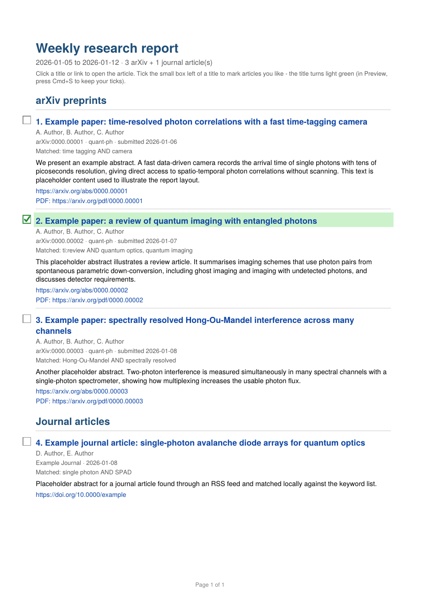

# Research Digest Bot

**A weekly, personal research digest from arXiv and journal feeds, delivered as one clean PDF.**

Research Digest Bot watches [arXiv](https://arxiv.org) and the RSS feeds of the journals you care
about. It filters them with your own keywords and authors, and once a week writes a single summary PDF
with titles, authors, abstracts and clickable links. It can also email you when the report is ready.

It runs quietly in the background on your own computer, uses **only the Python standard library**
(nothing to `pip install`), and keeps all your data local.

> Developed at **[CAPADS – Center of Applied Physics and Advanced Detection Systems](https://capads.fjfi.cvut.cz/home)**,
> Faculty of Nuclear Sciences and Physical Engineering, Czech Technical University in Prague.



---

## Features

- **arXiv search** with phrases, `AND` / `OR` / `ANDNOT`, author (`au:`) and title (`ti:`) searches.
- **Journal feeds** (Nature, Science, APS, Optica, IOP, Wiley, … any RSS/Atom feed), matched locally with the same keyword rules.
- **Topic filter** (arXiv categories plus required words) to keep off-topic papers out.
- **One PDF per week**: title, authors, abstract, matched keyword, and links to the abstract page and PDF.
- **"Like" tick boxes**: tick an article's box and its title turns light green. Ticks are saved in the PDF.
- **No duplicates**: the bot remembers what it has already reported.
- **Catches up** if your computer was off on report day.
- **Optional email** through macOS Mail (no password stored) or any SMTP server, with the PDF attached.
- **Cross-platform**: macOS (launchd), Linux (cron / systemd) and Windows (Task Scheduler).
- **Polite to arXiv**: respects the API rate limit (at least 3 s between calls) and sends a descriptive User-Agent.

## Quick start

```bash
git clone https://github.com/QuantumSatya/research-digest-bot.git
cd research-digest-bot
python3 digest.py --show-queries      # first run creates config.ini, keywords.txt, journals.txt, filters.txt
```

1. Edit **`keywords.txt`** (your topics and authors), **`filters.txt`** (your arXiv categories) and,
   if you like, **`journals.txt`**. The shipped examples are for photonics and quantum optics.
2. Edit **`config.ini`**: set `output_dir` and, if you want email, the `[email]` section.
3. Make a first report right away:
   ```bash
   python3 digest.py --now
   ```
4. Schedule it to run every day. The report is only made on your `report_weekday`, and on other days
   it just collects journal items.
   - macOS: `bash scripts/install_macos.sh`
   - Linux: `bash scripts/install_linux_cron.sh`
   - Windows: `powershell -ExecutionPolicy Bypass -File scripts\install_windows.ps1`

Requires **Python 3.8+**. That's it.

## Keyword syntax (keywords.txt)

| Line | Meaning |
|---|---|
| `quantum imaging` | exact phrase anywhere (title, abstract, authors, comments) |
| `time tagging AND camera` | both terms |
| `QKD OR quantum key distribution` | either term |
| `quantum imaging ANDNOT microscopy` | first but not second |
| `au:Padgett` | author surname |
| `au:Pan AND au:Jian` | surname + first name (for common surnames) |
| `ti:review AND single photon` | "review" in the title, phrase anywhere |
| `# ...` | comment / switched off |

Use one kind of operator per line. Run `python3 digest.py --show-queries` to see the exact arXiv queries.
Details: [docs/KEYWORDS.md](docs/KEYWORDS.md).

## Command line

```text
python3 digest.py                         normal run (call it daily; report on report_weekday)
python3 digest.py --now                   make a report now (since the last report)
python3 digest.py --now --from 2026-01-05 report for a chosen period (ignores "already seen")
python3 digest.py --show-queries          print the arXiv query for every keyword
python3 digest.py --test-email            send a test email
python3 rebuild_reports.py                re-render all existing reports with the current layout
```

## Output

```text
<output_dir>/
├── Report_2026-01-05_to_2026-01-12.pdf     one per week
├── Report_2026-01-12_to_2026-01-19.pdf
└── _state/                                 the bot's memory (don't delete)
    ├── seen.json                           already-reported papers, last report date
    ├── digest.log                          log of every run
    └── reports/*.json                      data behind each PDF (used by rebuild_reports.py)
```

## Documentation

- [How it works](docs/HOW_IT_WORKS.md): the weekly cycle, feeds, de-duplication and the PDF format.
- [Configuration](docs/CONFIGURATION.md): every setting in `config.ini`, `filters.txt` and `journals.txt`.
- [Keywords](docs/KEYWORDS.md): syntax, examples for several fields, and tips for good keywords.
- [Scheduling](docs/SCHEDULING.md): macOS, Linux and Windows, plus permissions.
- [Troubleshooting](docs/TROUBLESHOOTING.md): common problems and fixes.

## Privacy

Everything stays on your machine. The bot only contacts arXiv, the feed URLs you list, and your mail
server if you enable email. Your personal files (`config.ini`, `keywords.txt`, `journals.txt`,
`filters.txt`) are in `.gitignore`, so they are never committed.

## Acknowledgements

This project was developed within the
[CAPADS group](https://capads.fjfi.cvut.cz/home) (Center of Applied Physics and Advanced Detection
Systems) at the Faculty of Nuclear Sciences and Physical Engineering, Czech Technical University in
Prague. If the bot is useful to you, please cite it (see [CITATION.cff](CITATION.cff)), which gives credit to the
whole group.

Thank you to arXiv for use of its open access interoperability. This project is not affiliated with
arXiv or with any publisher. Please respect the
[arXiv API terms of use](https://info.arxiv.org/help/api/tou.html) and each publisher's feed terms.

## Contributing

Ideas, bug reports and pull requests are welcome. See [CONTRIBUTING.md](CONTRIBUTING.md). Keyword and
journal-list "packs" for other fields (astronomy, biology, ML, …) are especially welcome.

## License

[MIT](LICENSE)
